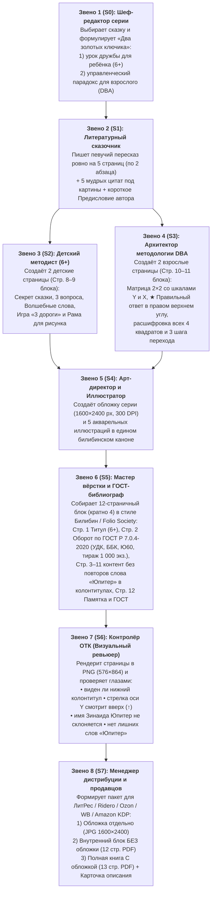

# Алгоритм создания книги серии «Сказки Мудрости Юпитера» (Конвейер S0–S8)

> [!IMPORTANT]
> **Авторская философия серии (Зинаида Юпитер, 26.10.2026):**
> * **Родительство — это не только про воспитание «лидеров»:** в эпоху искусственного интеллекта на первое место выходят качества, которые не заменит ни один алгоритм — **критическое и когнитивное мышление**, **стратегическое мышление наперёд**, **дружба, эмпатия, эмоциональный интеллект** и ясное понимание **«что такое хорошо, что такое плохо и как правильно поступить»**.
> * **Прививка от ошибок молодости:** большинство ошибок мы совершаем и накапливаем в самой молодости, когда ещё не умеем видеть последствия на шаг вперёд. Родители всегда хотят помочь, и книга даёт им тёплый, мудрый язык разговора с ребёнком.
> * **Вековая мудрость сказок каждого народа:** в сказках веками отточена жизненная проблематика — и дети, и взрослые мгновенно **узнают в героях сказок самих себя**, поэтому через сказку главные навыки мышления и человечности передаются глубже и бережнее всего.
>
> **Постоянный навык (скилл) установлен в систему:**
> Навык **`skazki-mudrosti-yupiter`** сохранён в обеих папках навыков вашего Mac:
> * [SKILL.md (.gemini)](file:///Users/zinaida/.gemini/config/skills/skazki-mudrosti-yupiter/SKILL.md) и [SKILL.md (.claude)](file:///Users/zinaida/.claude/skills/skazki-mudrosti-yupiter/SKILL.md)
> * Эталон вёрстки и матрицы DBA: [etalon-verstki-i-matrica-dba.md](file:///Users/zinaida/.gemini/config/skills/skazki-mudrosti-yupiter/references/etalon-verstki-i-matrica-dba.md)
> * Скрипт сборки пакета под продавцов: [build_book1_seller_ready.py](file:///Users/zinaida/.gemini/config/skills/skazki-mudrosti-yupiter/scripts/build_book1_seller_ready.py)

---

## 1. Схема конвейера: Кто, за кем и за что идёт (8 звеньев)

---

## 2. Таблица ответственности специалистов и ворот контроля (Quality Gates)

| Этап | Специалист (Роль) | От кого принимает | Что создаёт на выходе | Чек-лист контроля (нельзя идти дальше, пока не выполнено) |
| :---: | :--- | :--- | :--- | :--- |
| **S0** | **Шеф-редактор серии** | Старт заказа | Концепция одного выпуска (только 1 сказка в фокусе) + **выбор художественного стиля из 7 пресетов (`STYLE_PRESET`) под тематику и культуру сказки** | Выделена главная ошибка героев и способ её решения («Золотой мост»); выбран точный стиль оформления (Билибин / Гохуа / Раджастхан / Рэкхем / Арабеска / Античность / Нео-Ренессанс). |
| **S1** | **Литературный сказочник** | От Шеф-редактора (S0) | Текст сказки (5 страниц × 2 абзаца), 5 философских афоризмов под иллюстрации, Предисловие автора (2 абзаца) | Имя **Зинаида Юпитер** нигде не склоняется. В предисловии нет воды и сложных инструкций. |
| **S2** | **Детский методист (`6+`)** | От Сказочника (S1) | 2 страницы для ребёнка (Стр. 8–9 блока): крупный шрифт, 3 вопроса, свиток примирения, выбор из 3 дорог (`А, Б, В`), рама для рисунка | Возрастная категория — строго **`6+`**. Простые, добрые формулировки без взрослых терминов. |
| **S3** | **Архитектор DBA-методологии** | От Сказочника (S1) | 2 страницы для взрослых (Стр. 10–11 блока): Матрица `2×2` со шкалами `Y` и `X`, разбор всех 4 квадратов, 3 шага и таблица речей | 1) Шкала `Y` подписана снизу вверх (`Низкая → Высокая ↑`); 2) Шкала `X` подписана слева направо (`◄ Низкое → Высокое ►`); 3) **Правильный ответ (`★ Квадрат 4`) стоит строго в ПРАВОМ ВЕРХНЕМ УГЛУ**; 4) Все 4 квадрата понятно объяснены под матрицей. |
| **S4** | **Арт-директор и Иллюстратор** | От S1–S3 | 1 парадная обложка серии «Сказки Мудрости Юпитера» + 5 горизонтальных иллюстраций к сказке **в выбранном на S0 стиле `STYLE_PRESET`** | Единый музейный стиль иллюстраций под тематику сказки (Билибин для русских, Гохуа для китайских, Могольская миниатюра для индийских, Рэкхем для европейских и т.д.). |
| **S5** | **Мастер вёрстки и ГОСТ-библиограф** | От S1–S4 | Внутренний макет ровно на **12 страниц (кратно 4)** с цветовой палитрой и рамкой выбранного стиля `STYLE_PRESET` | 1) Фон, рамка и буквицы соответствуют стилю `STYLE_PRESET`; 2) Слово «Юпитер» стоит только на обложке, титуле (Стр. 1), обороте титула/подписи (Стр. 2) и в паспорте ГОСТ (Стр. 12) — **в колонтитулах Стр. 3–11 не повторяется**; 3) Проставлены УДК, ББК, авторский знак `Ю60`, знак `6+`, `Тираж 1 000 экз.`. |
| **S6** | **Контролёр ОТК (Визуальный ревьюер)** | От Верстальщика (S5) | Пакет контрольных PNG-скриншотов (`576×864 px`) и проверка `mdls -name kMDItemNumberOfPages` | Ни одна строка и ни один нижний колонтитул (`— ❧ Стр. N ... ❧ —`) не обрезаны; стрелка оси `Y` смотрит вверх (`↑`). |
| **S7** | **Менеджер дистрибуции (Продавцы)** | После визы ОТК (S6) | Готовая папка `<Название>_Пакет_Продавцам/` для загрузки в ЛитРес, Ridero, Ozon, WB, Amazon KDP | Обложка `1600×2400 JPG (300 DPI)` отделена от внутреннего блока `12 стр. PDF без обложки`; приложена текстовая карточка описания и SEO-ключей. |

---

## 3. Полистная карта эталонной книги (12 страниц внутреннего блока)

| Стр. блока | Полоса (разворот) | Содержание страницы | Стандарты и атрибуты |
| :---: | :---: | :--- | :--- |
| **Стр. 1** | Правая (нечётная) | **Парадный Титульный лист** | Серия «Сказки Мудрости Юпитера», автор **Зинаида Юпитер**, название сказки, экслибрис `❖ ♃ ❖`, `Москва • 2026`, круглый медальон **`6+`** |
| **Стр. 2** | Левая (чётная) | **Оборот титула по ГОСТ + Предисловие автора** | Сверху: `УДК`, `ББК`, авторский знак `Ю60`, библиографическое описание, аннотация, `ISBN`, `Тираж 1 000 экз.`, `© Зинаида Юпитер, 2026`. Внизу: «Слово к читателю» с буквицей и подписью **Зинаида Юпитер, DBA** |
| **Стр. 3–7** | Развороты сказки (5 стр.) | **Текст сказки с иллюстрациями** | На каждой странице: 1 иллюстрация в раме + философская цитата под ней + 2 абзаца сказки крупным шрифтом (`13pt`) с киноварной буквицей |
| **Стр. 8** | Левая (чётная) | **Детский урок `6+` (Лист 1)** | Миниатюра в рамке + «Секрет сказки» + «Три вопроса для беседы с ребёнком» (`I, II, III`) + свиток «Волшебные слова дружбы» |
| **Стр. 9** | Правая (нечётная) | **Детский урок `6+` (Лист 2)** | Игра-выбор «Как поступит мудрый друг?» (`А, Б, В`) + точечная рама для рисунка + 2 правила дружбы |
| **Стр. 10** | Левая (чётная) | **Управленческий урок DBA (Лист 1 — Матрица `2×2`)** | Вводная формула + Матрица `2×2` со шкалой `Y` слева (`Выгода союза ↑`) и шкалой `X` внизу (`Уважение к партнёру ►`), **`★ Квадрат 4` в правом верхнем углу** + блок расшифровки всех 4 квадратов под матрицей |
| **Стр. 11** | Правая (нечётная) | **Управленческий урок DBA (Лист 2 — Практикум)** | «Как перейти в Правый Верхний Квадрат (Квадрат 4)»: 3 шага + таблица речевых формулировок на 3 ситуации + строка для личного решения + формула лидера |
| **Стр. 12** | Левая (чётная, финальная) | **Итоговая памятка книги и Выпускные данные по ГОСТ** | Сверху: «Два золотых ключика сказки» (слева — для ребёнка `6+`, справа — для взрослого `DBA`). Внизу: официальный паспорт ГОСТ Р 7.0.4-2020 (`Формат 60×90/16`, `12 с. кратно 4`, `Гарнитура Georgia`, `Тираж 1 000 экз.`, `Заказ №`) |

---

## 4. Мировые языки, оттенки культур и «Три ключа локализации» (`T1–T6`)

### 4.1. Почему просят перевод на китайский, индийский, вьетнамский, арабский и африканские языки
1. **Китай (`简体中文`) и Вьетнам (`Tiếng Việt`):** культ воспитания «маленьких лидеров» и раннего стратегического мышления (*«36 стратагем для детей»*, притчи Чжуан-цзы) + уважение к русской классической иллюстрации (Иван Билибин).
2. **Индия (`English` + `हिन्दी Hindi`):** вся культура Индии выросла на **«Панчатантре»** (`Mitra-Samprapti`) — древних сказках о животных для обучения царских детей дипломатии и управлению. Для Индии и модуля БРИКС формула «сказка + управленческий разбор» является родным культурным кодом.
3. **Арабский мир — ОАЭ, Саудовская Аравия, Египет (`العربية`):** государственный бум семейного чтения и этики договора в странах Персидского залива (БРИКС) + гранты Шарджинской книжной ярмарки (*Sharjah Book Authority Translation Grant*, до \$4,000 на перевод детской/образовательной книги).
4. **Африка (ЮАР, Кения, Нигерия, Эфиопия):** 90% закупок на **английском (`EN`)** и **французском (`FR`)** + билингва с **суахили (`Kiswahili`, 200+ млн говорящих)** для образовательных программ БРИКС.
5. **Латинская Америка и Бразилия (`Español` / `Português`):** второй по объёму рынок Amazon KDP после США (Бразилия — страна БРИКС).

### 4.2. Технология «Трёх ключей локализации» (без буквального перевода)
* **Ключ 1 (Литературная транскреация сказки, Стр. 3–7):** русские присказки и идиомы переводятся высокими сказочными эквивалентами целевой культуры — в английском (`EN`) ритмическим слогом *The Folio Society* и Артура Рэнсома; в китайском (`ZH`) — четырёхсложными идиомами **чэнъюй (`成语`)** (*跋山涉水*, *碰了一鼻子灰*, *进退两难*); в хинди (`HI`) и вьетнамском (`VI`) — напевным строем восточных притч (*«Панчатантра»*). Реалии на иллюстрациях (*кафтан*, *самовар*) сохраняются с мягким пояснением внутри строки без сносок.
* **Ключ 2 (Деловой регистр бизнес-школ DBA, Стр. 10–11):** язык *Harvard Business Review / CEIBS / INSEAD*. В Китае и Вьетнаме «Золотой мост» подаётся через фундаментальное понятие **«Сохранить лицо партнёру и дать золотую ступеньку» (`顾全面子 / 留面子 / 给台阶下`)**.
* **Ключ 3 (Книжная типографика под каждый алфавит):**
  - `RU / EN / ES / PT / SW`: книжная антиква `Georgia` / `Palatino Linotype`;
  - `ZH-CN` (Китайский): императорская книжная антиква династии Сун `Songti SC` (`宋体`), **строгий запрет на курсив** (вместо него угловые кавычки `「…」` и `《…》`), `line-height: 1.58`;
  - `VI` (Вьетнамский): `Palatino` / `Noto Serif` с поддержкой двойной диакритики тонов (`ắ, ệ, ử`);
  - `HI` (Хинди): `Kohinoor Devanagari` с `line-height: 1.55` для верхней черты *широрекха*;
  - `AR` (Арабский): зеркальная вёрстка справа налево (`dir="rtl"`), включая разворот книги и Матрицу `2×2`, шрифт `Geeza Pro` / `Amiri`.

---

## 5. Печать в Китае (Шэньчжэнь): Весомый «Золотой Том» на 7–9 сказок (84–108 стр.) и Музейная 3D-тактильность (Утверждено 26.10.2026)
1. **Отказ от «ясельного меха в дырках» в пользу музейной 3D-тактильности (*Fine-Art Tactility*):**
   * Вместо меховых заплаток в дырках и пухлых наклеек (`1–3 года`) используется благородный тактильный стандарт для `6+` и взрослых: **тканевый/бархатный переплёт снаружи**, **глубокое рельефное 3D-тиснение золотом (конгрев / 3D Raised Embossing)** на обложке, орнаментальных рамках и буквицах, плотная фактурная бумага под пергамент (`140–157 г/м²`) и шёлковое ляссе.
2. **Принцип «Оба читают — оба учатся + Живая взаимосвязь с ребёнком» (стр. 8–11):**
   * Сказку читают вместе, и **учатся оба** — и ребёнок, и родитель. Главное — книга создаёт тёплый повод **обсудить всё вместе** в нужный жизненный момент.
   * Стр. 8–9 («Обсуждаем вместе с ребёнком, 6+») и Стр. 10–11 («Мудрость для родителей и разговор на вырост: Стратегическая матрица для семьи и жизни») образуют единый мост разговора родителя с ребёнком без сухого офисного разрыва.
3. **Обложка на языке совместного чтения детей и родителей (без пугающей аббревиатуры `DBA` на фасаде):**
   * На лицевой обложке: *«Поучительные сказки с разбором для детей и родителей: читаем вместе, обсуждаем и учимся дружить, понимать людей и думать на шаг вперёд»*, а степень `доктор делового администрирования (DBA)` — на титуле, в предисловии и на задней крышке как знак авторитета автора.
4. **Печатный том для Китая — 7–9 сказок (84–108 страниц + форзацы):**
   * Вместо тонкой книжки на 3 сказки (36 стр.) для офсетного тиража **1 000 экз.** собирается весомый том на **7–9 сказок (84–108 стр., RU и EN)**. Сначала заказываются **3–5 сигнальных экземпляров** (~\$120–\$220 за комплект, 5–7 дней, доставка в кампус МГУ-ППИ в Шэньчжэне, район Лонган, или в Москву), затем тираж **1 000 экз.** (себестоимость в Москве с доставкой: **~360–440 ₽/шт.** при розничной ценности **2 490 – 3 500 ₽**).
5. **Отдельная взрослая ветка «Сказки и Притчи для Руководителей: Hard DBA Edition (`16+`)» (Утверждено 26.10.2026):**
   * Параллельно с семейной серией (`6+`) выпускается серия **чисто для взрослых** — для руководителей, управленцев и людей, которые хотят выйти на новый уровень.
   * В ней сказка даётся **в коротком варианте как притча-кейс (1–2 страницы)**, а весь основной объём — это **жёсткий управленческий разбор DBA**: стратегические матрицы `2×2`, теория игр, управленческие инструменты, архитектура договоров и переговорные стратегии. На обложке этой серии крупно выносится **`Зинаида Юпитер, DBA`**.

---

## 4. Матрица 7 художественных стилей в зависимости от тематики сказки (`STYLE_PRESET`)

> [!IMPORTANT]
> **Главный принцип серии «Сказки Мудрости Юпитера»:**  
> **Каркас книги — единый и узнаваемый** (12 страниц по ГОСТ, медальон `6+`, Матрица `2×2` DBA с правильным ответом в правом верхнем углу, имя **Зинаида Юпитер** в 4 классических местах).  
> **Но художественный стиль иллюстраций, орнамент рамок и цветовая палитра вёрстки — РАЗНЫЕ и выбираются на шаге `S0` строго под тематику и культуру конкретной сказки!**  
> Нельзя рисовать индийскую «Панчатантру» или китайскую притчу с русскими деревянными избами Билибина — каждая подсерия получает свой подлинный музейный канон:

| Код пресета | Название художественного стиля и эталон | Для каких сказок и тематик применяется | Цветовая палитра и орнамент вёрстки (CSS) | Ключевые визуальные детали (`T2` при переводе) |
| :--- | :--- | :--- | :--- | :--- |
| **`STYLE_1`** | **«Русский терем и Золотой век»** *(И. Я. Билибин / В. М. Васнецов / Палех)* | Русские народные сказки, былины и басни И. А. Крылова (*«Журавль и цапля»*, *«Лиса и журавль»*, *«Морозко»*, *«Каша из топора»*) | Тёплый пергамент `#FAF3E3`, киноварь `#7B1E1E`, старое золото `#8C6228`, резной славянский бордюр | Вышитый кафтан (*kaftan*), медный самовар (*samovar*), резной терем (*carved timber hut*) |
| **`STYLE_2`** | **«Нефритовый свиток Поднебесной»** *(Китайская живопись Гохуа `国画` / шёлковая акварель династий Сун и Мин)* | Китайские притчи, сказки и стратагемы Чэнъюй (*«Лиса, одолжившая мощь Тигра»*, *«Старик Юйгун передвигает горы»*, *«Жёлтый журавль»*) | Рисовая бумага Сюань `#F7F5EE`, императорский нефрит `#1E5646`, киноварная печать `#A62424`, тонкая бамбуковая рамка с узелками счастья | Нефритовая печать (*jade seal*), бамбуковый свиток (*bamboo scroll*), павильон у лотосов (*lotus pavilion*) |
| **`STYLE_3`** | **«Золотой павлин и дворец Раджастхана»** *(Индийская миниатюра Моголов, Джайпура и Кангра)* | Индийские притчи из *«Панчатантры»*, *«Хитопадеши»* и историй о мудреце Бирбале (*«Синий шакал»*, *«Лев и бык»*, *«Обезьяна и крокодил»* — контур БРИКС в Индии) | Слоновая кость `#FDF8EC`, шафран и куркума `#C86D14`, королевский рубин и индиго `#6E1432`, резные арочные своды джали (*Jali*) | Дворцовый баньян (*banyan courtyard*), шёлковый тюрбан (*silk turban*), золотой кувшин (*brass kalash*) |
| **`STYLE_4`** | **«Европейский рыцарский фолиант»** *(Артур Рэкхем / Эдмунд Дюлак / The Folio Society London)* | Сказки братьев Гримм, Шарля Перро, Г. Х. Андерсена и европейские легенды (*«Новое платье короля»*, *«Кот в сапогах»*, *«Дикие лебеди»*) | Английская бумага верже `#F6F3EB`, глубокий оксфордский синий `#1B324F`, античная бронза `#8A6D3B`, викторианская гравюрная виньетка | Каменный замок (*stonekeep*), бархатный камзол (*velvet doublet*), ратушная площадь (*guildhall*) |
| **`STYLE_5`** | **«Лазурный купол и Арабеска Востока»** *(Персидская и арабская книжная миниатюра / Шелковый путь)* | Восточные сказки *«1001 ночи»*, притчи о Ходже Насреддине и мудрость купцов Востока (ОАЭ, Саудовская Аравия, Средняя Азия) | Песчаный пергамент `#FAF4E6`, самаркандская бирюза и лазурит `#145A6E`, сусальное золото `#B8860B`, геометрический звёздчатый гирих | Караван-сарай (*caravanserai*), чеканный фонарь (*brass lantern*), мозаичный дворик (*mosaic courtyard*) |
| **`STYLE_6`** | **«Античная мраморная колоннада»** *(Классическая гравюра Эллады и Рима / Уолтер Крейн)* | Античные басни Эзопа, Федра, Лафонтена и мифы о стратегии (*«Черепаха и заяц»*, *«Ворона и лисица»*, *«Стрекоза и муравей»*) | Светлый мрамор `#F9F8F4`, античная терракота `#9E3B24`, оливковое золото `#756B38`, классический греческий меандр по периметру | Оливковая роща (*olive grove*), мраморный портик (*marble portico*), амфора (*clay amphora*) |
| **`STYLE_7`** | **«Нео-Ренессанс Будущего»** *(Современная тёплая книжная живопись / Академия Юных Стратегов)* | Авторские современные сказки **Зинаиды Юпитер** про семейные династии, финансовую грамотность, ИИ-помощников и созидание будущего | Чистый жемчужный лист `#FAF9F6`, королевский сапфир `#1E3F66`, солнечное золото `#C59B27`, лаконичная неоклассическая рамка | Семейная библиотека (*family library*), звёздный компас (*starlight compass*), город будущего (*garden city*) |

---

## 5. Обязательный шаг S8: Сохранение модульного паспорта истории (`YAML` + `JSON`) и сборка в 1 клик (Утверждено 27.10.2026)

Для каждой книги серии **«Сказки Мудрости Юпитера»** параллельно с итоговым вёрстанным PDF обязательно сохраняется чистый структурированный паспорт единицы истории (`*_story_unit.yaml` и `*_story_unit.json`) в папке `04_Модульная_база_единиц_историй/`:
1. **Что входит в паспорт истории:**
   - Текст сказки по 5 сценам и афоризмы под иллюстрациями (отдельно от HTML/PDF-вёрстки);
   - Мораль и «Два золотых ключика» (для ребёнка `6+` и для взрослого руководителя `DBA`);
   - Матрица `2×2` по двум осям (`Ось Y` и `Ось X`) с правильным ответом в **Правом Верхнем Квадрате (`★ Квадрат 4`)** и таблицей переговорных перехватов;
   - Вопросы для беседы с ребёнком, игра выбора «Три дороги», творческое задание и 5 контрольных вопросов руководителя;
   - Промпты и пути к иллюстрациям по сценам (`STYLE_1..STYLE_7`).
2. **Сборка производных продуктов в 1 клик (оцифрованы все 16 выпусков — Книги 1–15 Золотого образца + Книга 16 «Курочка Ряба»):**
   - Команда: `/usr/bin/python3 ~/.claude/skills/skazki-mudrosti-yupiter/scripts/assemble_story_products.py --all`
   - Автоматически собирает в `05_Интерактивные_разборы_и_Курсы/` по всем 16 книгам (`book1_zhuravl_i_caplya` … `book16_kurochka_ryaba`):
     - `*_interactive_case.md` — интерактивный разбор и тренажёр;
     - `*_ai_mentor_config.json` — готовый системный промпт и сценарий для ИИ-наставника;
     - `*_course_module.md` — готовый учебный модуль курса «Предпринимательское мышление через сказки народов мира».

---

## 6. Полная команда мирового уровня: 18 экспертов в 3 контурах (Утверждено 27.10.2026)

Полный устав команды, мировые ориентиры (*The Folio Society, DK Publishing, Harvard Business Review Press, Scholastic, HBS/INSEAD Case Method, ГК РФ ч. 4 / ФЗ-436 / ФЗ-53, Бернская конвенция / CPSIA / CISG / UNIDROIT*) и «Пять ворот качества» закреплены в документе [Совет_Экспертов_и_Команда_Продукта.md](file:///Users/zinaida/Documents/Архив/Книги/Сказки%20Мудрости%20Юпитера/01_Стратегия_Алгоритмы_и_Каталог/Совет_Экспертов_и_Команда_Продукта.md). Над каждым продуктом серии работают **18 профильных экспертов в 3 контурах** под руководством автора серии **Зинаида Юпитер, DBA**:

1. **Контур 1 — Смысл, Стратегия, Педагогика и Живое Слово (6 ролей):**
   - **1. Доктор делового администрирования (DBA):** подбирает точный управленческий инструмент под сюжет сказки и проверяет математическую ортогональность осей `Y` и `X` в Матрице `2×2` (`Кв. 1 (-;-)`, `Кв. 2 (+Y;-X)`, `Кв. 3 (-Y;+X)`, `★ Кв. 4 (+Y;+X)` строго в правом верхнем углу).
   - **2. Стратег уровня McKinsey:** выстраивает разбор по принципу `MECE` (4 роли, 2 ловушки, 3 шага перехода с глаголами действия, таблица перехватов) и вычищает англицизмы.
   - **3. Преподаватель и Методист обучения (EdTech):** проектирует 3 сократических вопроса, тренажёр «Три дороги (`А, Б, В`)», 5 точек самопроверки и модули учебного курса (`*_course_module.md`).
   - **4. Литературный сказочник и Мастер транскреации (`T1–T6`):** отвечает за певучий язык сказки (5 страниц в `6+` и 3 страницы за 1,5 минуты в `12+` со всеми поговорками), афоризмы и локализацию на 12 языков мира.
   - **5. Редактор звучания вслух, ритмики и режиссёр аудиоспектаклей (*Scholastic / Penguin Audio*):** проверяет дыхание фразы при чтении вслух перед сном, «крючок переворота страницы» и разметку ударений (`́`, `ё`) для ролевых аудиоспектаклей ElevenLabs.
   - **6. Эксперт по кросс-культурному коду, этнографии и рынкам БРИКС / Мира:** проверяет костюмы, жесты на иллюстрациях и культурные мосты под Китай (`成语`, сохранение лица `留面子`), Индию (`Панчатантра`), арабский мир и США/ЕС.

2. **Контур 2 — Совет Хранителей 4 Целевых Аудиторий (4 роли с правом вето):**
   - **7. Эксперт по аудитории детей (`6+`, 6–10 лет):** проверяет понятность на слух, отсутствие занудного морализаторства и вовлекающую механику игры и рисунка.
   - **8. Эксперт по аудитории взрослых семей (Родители и старшее поколение):** проверяет прохождение «Тест читательницы 60+», теплоту семейной матрицы и замену родительских упрёков на добрые домашние ритуалы.
   - **9. Эксперт по аудитории управленцев (Директора, РОПы, тимлиды):** проверяет узнаваемость рабочих типажей, применимость 4 крылатых фраз-кодов на планёрке и точность управленческих перехватов.
   - **10. Эксперт по аудитории предпринимателей (Собственники и фаундеры):** проверяет защиту активов, долей, маржи и партнёрских соглашений на берегу в разборе и учебном курсе.

3. **Контур 3 — Визуальный канон, Инфографика, Полиграфия, ИИ, Рынок и Право РФ + Мир (8 ролей):**
   - **11. Художник-иллюстратор музейного канона:** отвечает за 7 пресетов `STYLE_1..STYLE_7`, единство персонажей и отсутствие текста внутри картин.
   - **12. Дизайнер инфографики и визуализации матриц (*DK Publishing / HBR Visuals*):** отвечает за мгновенную считываемость Матрицы `2×2` за 3 секунды, векторы осей `Y ↑` и `X ►`, контраст `★ Квадрата 4` и когнитивную разгрузку таблиц.
   - **13. Мастер книжной вёрстки и ГОСТ-библиограф:** отвечает за 13 страниц (`1 обложка + 12 блок кратно 4`), микротипографику без висячих строк и обрезанных колонтитулов, выпускные данные по ГОСТ Р 7.0.4-2020.
   - **14. Инженер офсетной полиграфии и музейной 3D-тактильности (*The Folio Society / Taschen*):** отвечает за профили `CMYK`, клише 3D-конгрева и золотой фольги, вылеты `Bleed`, поле корешка `Gutter`, ниткошвейный переплёт на `180°` и приёмку сигнальных образцов в Шэньчжэне.
   - **15. Архитектор диалогового ИИ-наставника и поведенческого переноса (*Khanmigo / HBS*):** отвечает за сократические промпты `*_ai_mentor_config.json`, интерактивные кейсы `*_interactive_case.md` и петлю внедрения навыка за 24 часа.
   - **16. Продюсер конверсии маркетплейсов и первого клика:** проверяет обложку по «Тесту иконки 0,8 секунды (`120 px`)», собирает продающие первые 3 разворота и SEO-ключи.
   - **17. Профильный Юрист по праву РФ (*ГК РФ ч. 4, ФЗ-436, ФЗ-53, ст. 54.1 НК РФ*):** проверяет чистоту *Public Domain* фольклора в РФ и отсутствие охраняемых советских/российских переводов, возрастную безопасность **ФЗ-436 (`6+` / `12+`)**, чистоту государственного языка (**ФЗ-53**, 0 англицизмов) и правовую выверенность договорных и корпоративных рекомендаций по ГК РФ.
   - **18. Юрист по международному праву (*Бернская конвенция, US Copyright Act, CPSIA, EU AI Act / GPSR, GAPP КНР, UAE Media Council, UNIDROIT, CISG*):** проверяет глобальный *Public Domain* (без образов *Disney* и западных переводов XX в.), защиту гибридного авторства и ИИ-деклараций (*USCO / EU AI Act / KDP*), цензурный допуск КНР (`GAPP`) и стран Персидского залива (`GCAM` / гранты Шарджи), сертификацию детских книг (`CPSIA / COPPA / GDPR-K`), таможенные коды (`HS 4901/4903`), контракты с фабриками Шэньчжэня (*Incoterms 2020*) и международные правовые инструменты в книгах `12+`.

