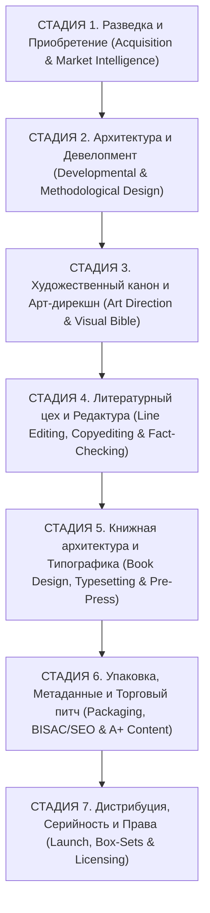
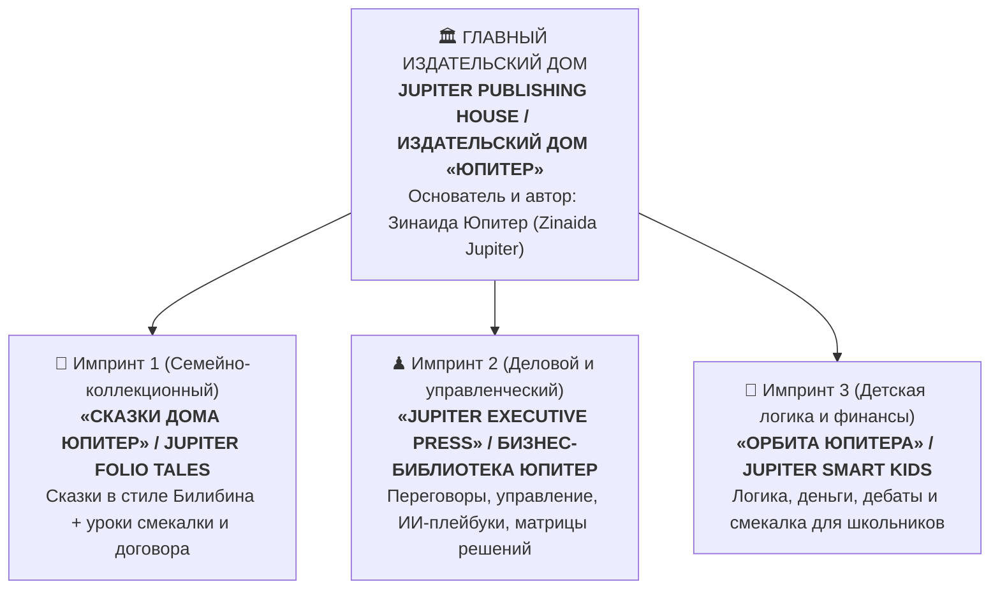

# АНАТОМИЯ МИРОВЫХ ИЗДАТЕЛЬСТВ И АРХИТЕКТУРА БРЕНДА «ЮПИТЕР / JUPITER»

---

## ЧАСТЬ 1. ПО КАКИМ СТАДИЯМ РАБОТАЮТ ЛУЧШИЕ ИЗДАТЕЛЬСКИЕ ЦЕНТРЫ МИРА И КТО В НИХ РАБОТАЕТ

В ведущих мировых домах книги — **Penguin Random House** (крупнейший коммерческий гигант), **The Folio Society** и **Taschen** (эталоны коллекционной иллюстрированной книги), **Harvard Business Review Press** (эталон деловой книги) и **Usborne / Chronicle Books** (лидеры детских развивающих серий) — книга проходит **7 жёстких стадий (Stage-Gate Process)**.

Ни один этап не пропускается. Именно поэтому их книги стоят в 2–3 раза дороже самиздата и продаются миллионами экземпляров.

### Подробная карта всех 7 стадий и 14 специалистов мирового издательства

| Стадия | Какие специалисты работают | В чём их секретная работа (чего не делают новички) | Что мы забираем в наш стандарт «Юпитер» |
| :--- | :--- | :--- | :--- |
| **Стадия 1. Разведка и Закупка (Acquisition)** | **1. Acquisition Editor** (Редактор по закупкам) **2. Literary Scout & Data Analyst** (Литературный скаут и аналитик спроса) | Не гадают «что бы написать». Считают ёмкость полки, смотрят поисковые запросы (Wordstat / Amazon Search), ищут **«незакрытый стык»** (например: классическая сказка + переговорный урок для родителей) и считают маржинальность серии минимум на 20–50 книг вперёд. | Каждая книга запускается только под проверенный поисковый кластер (Вордстат / Google US) и сразу входит в серию из 10–50 книг. |
| **Стадия 2. Архитектура и Метод (Development)** | **3. Developmental Editor** (Ведущий редактор структуры) **4. Methodological / Executive Advisor** (Методист детского развития / Консультант по переговорам) | Выстраивают **ритм книги**: сколько слов на странице, где читатель устаёт, где должен быть вопрос ребёнку, а где — таблица для взрослого. Следят, чтобы детский блок был простым и игровым, а взрослый — твёрдым и практичным (без «воды»). | Чёткая формула: **5 страниц сказки + 2 страницы детской игры-смекалки + 2 страницы взрослого переговорного урока**. |
| **Стадия 3. Арт-дирекшн и Визуальный канон (Art Direction)** | **5. Art Director** (Арт-директор издания) **6. Book Illustrator** (Художник-иллюстратор) **7. Cover Designer** (Дизайнер продающей обложки) | В *Folio Society* и *Chronicle Books* иллюстратор и дизайнер обложки — это **разные профессии**! Иллюстратор рисует мир и героев (по единой «Библии персонажей»), а дизайнер обложки отвечает за то, чтобы название читалось за **0,3 секунды** на маленькой иконке маркетплейса. | Единый стиль иллюстраций в духе Билибина/акварели + контрастная обложка с фирменным знаком Юпитера. |
| **Стадия 4. Литературный цех (Editorial)** | **8. Line & Style Editor** (Литературный редактор стиля) **9. Copyeditor & Proofreader** (Корректор и вычитчик вслух) | В детских и семейных редакциях текст обязательно **читают вслух (Read-Aloud Test)**: если язык спотыкается на длинном предложении, фразу переписывают. Убирают канцелярит, штампы и повторы. | Живой, певучий русский слог (и естественный литературный английский для США) с короткими абзацами. |
| **Стадия 5. Книжная архитектура и Вёрстка (Book Production)** | **10. Book Architect / Typographer** (Книжный архитектор-типограф) **11. Pre-press Engineer** (Инженер допечатной подготовки) | Создают **ощущение дорогой книги**: подбирают книжную антикву (гарнитуру с засечками), рисуют **буквицы (инициалы)**, единые орнаментальные рамки, колонтитулы, колонцифры, **авантитул, титульный лист с гербом издательства (колофоном)** и следят, чтобы ни одна строка не «висела» на пустой странице. | Единая пергаментная вёрстка с двойной золотой рамкой, буквицами, миниатюрами и строгим контролем количества страниц. |
| **Стадия 6. Коммерческая упаковка (Packaging & SEO)** | **12. Metadata & Category Specialist** (Специалист по метаданным и категориям Amazon/Ozon) **13. Copywriter (Blurb Writer)** (Мастер продающих аннотаций) | Пишут текст для задней обложки и карточки товара по формуле **«Крючок боли → Почему старые способы не работают → Что внутри книги → Для кого»**. Подбирают 7 скрытых ключевых фраз и 3 точные категории, где меньше конкурентов и выше чек. | Готовый SEO-пакет (название, подзаголовок, аннотация, 7 ключей) под каждую книгу для РФ и США. |
| **Стадия 7. Серийность и Экосистема (Series & Rights)** | **14. Series Publisher / Brand Director** (Издатель серии и хранитель бренда) | Превращает одну книгу в **коллекцию**: ставит на последнюю страницу каждой книги анонс следующих выпусков серии (*«Соберите всю коллекцию»*), объединяет книги по 5 штук в подарочные комплекты (Box-Sets) и выпускает рабочие тетради. | В конце каждой книги — витрина всей серии Дома «Юпитер», чтобы покупатель одной книги покупал ещё 5–10. |

> [!IMPORTANT]
> **Каких 3 маленьких деталей великих издательств сейчас не хватает в наших PDF (и мы можем добавить их за 5 минут):**
> 1. **Классический Титульный лист (Title Page) с гербом-колофоном Издательского Дома** и девизом серии;
> 2. **Краткое слово «От Издателя» (Зинаиды Юпитер)** — 5 строк о том, как читать эту книгу вдвоём с ребёнком за 15 минут вечером;
> 3. **Коллекционный штамп внизу последней страницы**: *«Книга I из Золотого Собрания. Следующий выпуск: Книга II — "Лиса и Журавль"»* (именно это заставляет родителей собирать всю полку!).

---

## ЧАСТЬ 2. ДУМАЕМ НАД БРЕНДОМ: КАК СДЕЛАТЬ ФАМИЛИЮ «ЮПИТЕР / JUPITER» ЛЕГЕНДОЙ РЫНКА

Фамилия **Юпитер (Jupiter)** — это редчайший подарок для издательского бизнеса и в России, и в США/Европе:
1. **Фонетика и запоминаемость:** Слово «Юпитер / Jupiter» знают 100% людей на планете с детства. Его невозможно забыть или написать с ошибкой.
2. **Культурный код в истории и деловом мире:**
   * В античной традиции **Юпитер (Jove)** — верховный хранитель **Закона, Клятвы, Честного Договора и Высшей Мудрости** (именно он покровительствовал справедливому суду, гостеприимству и союзам между людьми!).
   * В астрономии **Юпитер** — самая большая планета-гигант, которая своей гравитацией **защищает Землю от комет** и удерживает вокруг себя целую семью из десятков спутников (идеальная метафора Мудрого Родителя и Сильного Руководителя!).
   * В истории книгопечатания великие дома всегда строились вокруг сильной фамилии и символа: *Penguin*, *Folio*, *Assouline*, *Taschen*, *Gallimard*, *Альпина*, *МИФ*.

---

### Секрет крупных издательств: Архитектура «Зонтичный Дом + 2 Импринта»

В мировом книгоиздании никогда не смешивают на одной вывеске детские сказки и жёсткие бизнес-книги, но всегда объединяют их **одним главным Издательским Домом**.
Например, у **Penguin Random House** есть детский импринт **Puffin Books** и деловой импринт **Portfolio**.

Для бренда **Зинаиды Юпитер** идеально работает точно такая же двухступенчатая архитектура:

---

### 5 вариантов позиционирования и названия Бренда (выберите тот, который откликается сильнее всего)

#### Вариант 1. Аристократический и вечный (Как *The Folio Society*, *Assouline*, *Gallimard*)
* **Русское имя бренда:** **Издательский Дом «Юпитер»** (или **Дом Книги Зинаиды Юпитер**)
* **Международное имя (Amazon):** **House of Jupiter Press** (или **Jupiter Folio Editions**)
* **Название сказочной серии:** *«Золотое собрание сказок и премудрости Дома Юпитер»* / *The House of Jupiter Illustrated Fables*
* **Фирменный знак (Экслибрис):** Золотая планета Юпитер в кольце старинной астролябии над раскрытой книгой.
* **Слоган:** *«Древние сказки для детей. Высшая школа договора для взрослых»* (*Timeless Tales for Children. Strategic Wisdom for Leaders*).

#### Вариант 2. Современный интеллектуальный бестселлер (Как *Harvard Business Review Press* + *МИФ*)
* **Русское имя бренда:** **Лаборатория Стратегии и Сказок Зинаиды Юпитер** (коротко на обложке: **Бренд «ЮПИТЕР • JUPITER»**)
* **Международное имя (Amazon):** **Jupiter Strategy & Wisdom Press**
* **Название сказочной серии:** *«Умные сказки Зинаиды Юпитер: Читаем с ребёнком, побеждаем в переговорах»*
* **Фирменный знак (Экслибрис):** Астрономический знак Юпитера (`♃`), переходящий в золотое перо и шахматную корону.
* **Слоган:** *«Одна сказка вечером — два сильных ума в семье»*.

#### Вариант 3. Космическо-семейный («Планета-гигант и её спутники»)
* **Русское имя бренда:** **Издательство «Орбита Юпитера» (Авторская серия Зинаиды Юпитер)**
* **Международное имя (Amazon):** **Jupiter Orbit Publishing**
* **Легенда бренда:** Как планета-гигант Юпитер ведёт за собой свои спутники и защищает их от столкновений, так и мудрый родитель/руководитель через истории передаёт детям и команде законы сильного мышления.
* **Название сказочной серии:** *«Сказки Большой Орбиты: Доброе сердце и ясный ум»*.

#### Вариант 4. Личный авторский бренд №1 (Как *Ицхак Адизес*, *Роберт Грин*, *Нассим Талеб*)
* **Главный акцент:** На первом месте — не название издательства, а крупное имя автора: **ЗИНАИДА ЮПИТЕР (ZINAIDA JUPITER)** как создателя собственного метода **«Сказочная дипломатия / Fable Negotiation Method»**.
* **Надпись над заголовком:** *Метод Зинаиды Юпитер • Семейная и управленческая классика*
* **Почему это сильно:** Люди охотнее подписываются на живого автора с яркой фамилией, чем на абстрактное издательство.

#### Вариант 5. Гибридный эталон (Рекомендуемый фаворит для Фабрики из 300 книг)
Соединить **Личный бренд Автора** и **Статус Издательского Дома**:
* **Автор на обложке:** **Зинаида Юпитер / Zinaida Jupiter**
* **Издательский штамп (внизу обложки и на титульном листе):** **Издательский Дом «ЮПИТЕР» • JUPITER HOUSE PRESS** (с золотым знаком `♃` и планетой в кольце).
* **Две чёткие серии внутри Дома:**
  1. **«Сказки Мудрости Юпитера» (*Jupiter Wisdom Tales*)** — для сказок в стиле Билибина (детский + управленческий разбор);
  2. **«Управленческий Канон Юпитера» (*Jupiter Executive Canon*)** — для деловых книг по переговорам, ИИ и матрицам решений.

---

### Как выглядит фирменный «Паспорт Книги» великого издательства (что мы можем встроить в каждую книгу)

Если мы берём **Гибридный эталон (Вариант 5)** или **Аристократический (Вариант 1)**, мы можем оформить шапку первой страницы каждой сказки по канону лучших домов мира:
1. **Золотой экслибрис Дома «Юпитер» (`✦ ♃ ИЗДАТЕЛЬСКИЙ ДОМ «ЮПИТЕР» • КНИГА I ✦`)**;
2. **Подпись под заголовком:** *«В пересказе и с управленческим разбором Зинаиды Юпитер»*;
3. **Внизу последней страницы (Стр. 11) — коллекционная плашка серии:** *«Золотое собрание "Сказки Мудрости Юпитера". Книга I: Журавль и Цапля • Книга II: Лиса и Журавль • Книга III: Вершки и Корешки»*.

Какой из 5 вариантов бренда и какая формулировка подписи **«Зинаида Юпитер / Издательский Дом Юпитер»** вам ближе всего по духу?
