# Полная Команда Экспертов Мирового Уровня (18 ролей в 3 контурах) для Продуктовой Экосистемы «Сказки Мудрости Юпитера»

**Автор серии и Председатель Совета:** Зинаида Юпитер, доктор делового администрирования (DBA)  
**Эталоны мирового бенчмарка:** *The Folio Society* (музейная книга и полиграфия), *DK Publishing* (визуализация схем и матриц), *Harvard Business Review Press & Patrick Lencioni* (бизнес-притчи и управленческие модели), *Scholastic* (детское и семейное чтение вслух), *Harvard Business School / INSEAD Case Method & Khanmigo* (интерактивные кейсы и сократический ИИ-наставник), *Национальное право РФ (ГК РФ ч. 4, ФЗ-436, ФЗ-53) и Международное издательское и торговое право (Бернская конвенция, US Copyright Act, CPSIA, EU AI Act / GPSR, GAPP КНР, UAE Media Council, Принципы УНИДРУА, CISG)*.

---

## 1. Почему базовых 10 ролей недостаточно и какие 8 узких ролей добавлены по мировому опыту (включая Юриста по праву РФ и Юриста по международному праву)

Анализ производственных цепочек ведущих мировых издательств и образовательных платформ показал, что гибридный продукт **«Сказки Мудрости Юпитера»** (одновременно коллекционный иллюстрированный фолиант, семейная книга `6+`, управленческий разбор `12+/DBA`, аудиоспектакль, ИИ-наставник и международный курс на 12 языках) стоит на стыке **5 индустрий**.

В базовом списке из 10 специалистов оставались **8 критических слепых зон**, которые в мировых домах закрывают отдельные узкие профили:

1. **Информационный дизайнер матриц и схем (*Information Designer*, стандарт *DK Publishing / HBR Press*):**
   - Художник рисует акварель Билибина, а верстальщик ставит колонки текста. Но чтобы Матрица `2×2`, векторы осей `Y ↑` и `X ►`, таблицы перехватов и карточки «Три дороги» считывались глазом за **3 секунды** без визуального шума, нужен отдельный архитектор инфографики.
2. **Редактор звучания вслух, ритмики и режиссёр аудиоспектаклей (*Read-Aloud Pacing Editor & Audio Director*, стандарт *Scholastic / Penguin Audio*):**
   - Семейную книгу читают **вслух ребёнку перед сном**, управленческую читают за **90 секунд**, а по каждой книге выходит ролевой аудиоспектакль. Этот эксперт выверяет длину дыхания фразы, ставит «крючок переворота страницы» (*page-turn hook*) в конце каждой полосы и размечает ударения (`́`, `ё`) и интонации ролей.
3. **Эксперт по кросс-культурному коду, этнографии и табу БРИКС / MENA / США-ЕС (*Cultural & Folklore Authenticity Consultant*, стандарт *Bologna / Sharjah / Beijing Book Fairs*):**
   - Проверяет не только текст перевода, но и визуальные детали иллюстраций под рынки Китая, Индии, ОАЭ/Саудовской Аравии и США/Европы (например: в китайском стиле `STYLE_2` запах халата *ханьфу* должен быть строго слева направо `右衽`, иначе в КНР это погребальная одежда; в арабских и индийских изданиях проверяются жесты рук, символика животных и архитектурные детали).
4. **Инженер офсетной полиграфии, цветопробы и музейной 3D-тактильности (*Print Production & Tactility Controller*, стандарт *The Folio Society / Taschen*):**
   - Отвечает за переход от экранного `RGB PDF` к физическому производству «Золотого Тома» (84–108 стр., тираж 1 000 экз. в Шэньчжэне): профили `CMYK`, отдельные векторные штампы для золотой фольги и 3D-конгрева, вылеты под обрез (`Bleed 3–5 mm`), поле корешка (`Gutter`), направление волокон пергаментной бумаги и ниткошвейное скрепление (*Smyth-sewn binding* с раскрытием на `180°`).
5. **Архитектор диалогового ИИ-наставника и поведенческого переноса (*Conversational AI Pedagogist & Behavioral Scientist*, стандарт *HBS / Khanmigo*):**
   - Отвечает за то, чтобы ИИ-наставник (`*_ai_mentor_config.json`) вёл ребёнка и руководителя по сократическому методу (наводящими вопросами без готовых шпаргалок), а книга запускала **петлю поведенческого переноса через 24 часа и 7 дней** (конкретное действие за ужином или на завтрашней планёрке).
6. **Продюсер конверсии маркетплейсов и первого клика (*Marketplace Conversion & Thumbnail Strategist*, стандарт *Amazon KDP Top-1% / Ozon / ЛитРес*):**
   - Проверяет обложку по **«Тесту иконки 0,8 секунды»** (читаемость названия и героя при высоте превью `120 px` на экране смартфона), собирает продающие первые 3 разворота (*Look Inside*) и SEO-ключи по реальному покупательскому спросу.
7. **Профильный Юрист по праву РФ (авторское, издательское, детское и корпоративное право РФ):**
   - Проверяет чистоту *Public Domain* по ч. 4 ГК РФ (ст. 1259, 1260, 1282), возрастную безопасность **ФЗ-436 (`6+` / `12+`)**, чистоту государственного языка (**ФЗ-53** в ред. 2025–2026 гг. — 0 англицизмов), отстройку от ФЗ-323 и юридическую выверенность деловых рекомендаций в `★ Квадрате 4` по ГК РФ и ст. 54.1 НК РФ.
8. **Юрист по международному праву (международное авторское право, регуляторика БРИКС/США/ЕС/MENA, таможня и трансграничные контракты):**
   - Закрывает **5 международных правовых контуров** при выходе на глобальные рынки (США, ЕС, КНР, Индия, ОАЭ/Саудовская Аравия, Бразилия, Африка):
     1) **Глобальная чистота *Public Domain* по Бернской конвенции и *US Copyright Act (17 U.S.C.)*:** проверяет, чтобы в международных версиях не нарушались права зарубежных правообладателей на поздние адаптации (например, образы и песни *Disney* 1933 г. в «Трёх поросятах» или современные переводы *Penguin / Oxford*), опираясь строго на первоисточники до 1900 г.
     2) **Международная защита гибридного авторства и комплаенс ИИ (*US Copyright Office AI Guidance, EU AI Act Art. 50, Amazon KDP AI Disclosure, Закон об авторском праве КНР*):** оформляет защиту составного произведения, текста и методологии `© Zinaida Jupiter, DBA` и контролирует корректность деклараций на мировых площадках.
     3) **Регуляторные и цензурные фильтры стран БРИКС, Персидского залива (MENA) и Азии (`GAPP/NPPA` КНР, `UAE Media Council`, `GCAM` Саудовская Аравия):** проверяет книги перед подачей на международные гранты (*Sharjah Book Authority Translation Grant*) и ко-издания (включая обязательную замену образов поросят в Книге 4 для исламских рынков MENA на притчу о «Трёх братьях-бобрах / строителях каменной крепости»).
     4) **Сертификация безопасности детских товаров и данных в США и ЕС (`CPSIA`, `EU GPSR`, `COPPA`, `GDPR-K`):** контролирует наличие *Tracking Label* и сертификата безопасности красок/фольги (*CPC*) при офсетной печати в Шэньчжэне, а также режим нулевого сбора персональных данных детей (`Zero PII`) в ИИ-наставнике.
     5) **Трансграничные контракты, таможня (`HS Code 4901.99 / 4903.00`, Флорентийское соглашение ЮНЕСКО о беспошлинном ввозе книг), налоги на роялти (`W-8BEN`) и международный арбитраж (`UNIDROIT`, `CISG`, `HKIAC / DIAC / SIAC`):** защищает права издателя в договорах с китайскими фабриками (*Incoterms 2020*, запрет на дополнительный тираж) и усиливает управленческие разборы `12+` нормами международного контрактного права.

---

## 2. Полная структура команды: 18 экспертов в 3 контурах

```mermaid
flowchart TD
    Z["<b>Председатель Совета и Автор серии</b><br/>Зинаида Юпитер, DBA"] --> CA["<b>КОНТУР 1: Смысл, Стратегия, Педагогика и Слово (6 ролей)</b>"]
    Z --> CB["<b>КОНТУР 2: Совет Хранителей 4 Целевых Аудиторий (4 роли)</b>"]
    Z --> CC["<b>КОНТУР 3: Визуальный канон, Полиграфия, ИИ, Рынок и Право РФ + Мир (8 ролей)</b>"]

    CA --> R1["1. Доктор бизнеса (DBA) и Архитектор инструментов"]
    CA --> R2["2. Стратег уровня McKinsey (MECE и чистота логики)"]
    CA --> R3["3. Преподаватель и Методист обучения (EdTech & Курсы)"]
    CA --> R4["4. Литературный сказочник и Мастер транскреации (T1–T6)"]
    CA --> R5["5. Редактор чтения вслух, ритмики и аудиоспектаклей"]
    CA --> R6["6. Эксперт по культурному коду и рынкам БРИКС / Мира"]

    CB --> R7["7. Эксперт по аудитории детей (6–10 лет)"]
    CB --> R8["8. Эксперт по аудитории взрослых семей (Родители и 60+)"]
    CB --> R9["9. Эксперт по аудитории управленцев (Директора и РОПы)"]
    CB --> R10["10. Эксперт по аудитории предпринимателей (Собственники и фаундеры)"]

    CC --> R11["11. Художник-иллюстратор музейного канона (STYLE_1..7)"]
    CC --> R12["12. Дизайнер инфографики и визуализации матриц (DK / HBR)"]
    CC --> R13["13. Мастер книжной вёрстки, типографики и ГОСТ Р 7.0.4-2020"]
    CC --> R14["14. Инженер офсетной полиграфии и 3D-тактильности (Folio)"]
    CC --> R15["15. Архитектор ИИ-наставника и поведенческого переноса"]
    CC --> R16["16. Продюсер конверсии маркетплейсов и первого клика"]
    CC --> R17["17. Юрист по праву РФ (ГК РФ ч. 4, ФЗ-436, ФЗ-53, договоры)"]
    CC --> R18["18. Юрист по международному праву (Берн, США/ЕС/БРИКС/MENA, CISG)"]
```

---

## 3. Детальная матрица всех 18 экспертов: зона ответственности, мировой стандарт и критерий вето

### КОНТУР 1. Смысл, Стратегия, Педагогика и Живое Слово (Роли 1–6)

| № | Роль эксперта | Мировой ориентир | За что отвечает в продукте | Железный критерий приёмки (Право вето) |
| :---: | :--- | :--- | :--- | :--- |
| **1** | **Доктор делового администрирования (DBA) и Хранитель управленческих инструментов** | *Harvard Business School / CEIBS / INSEAD* | Точный подбор классического управленческого инструмента под сюжет сказки (Гарвардский мост, защита активов, баланс Плода и Кормилицы, предел пропускной способности, антихрупкость и др.) и математическая архитектура Матрицы `2×2`. | Оси `Y` и `X` строго независимы; каждый квадрат стоит на своих координатах: `Кв. 1 (-Y;-X)`, `Кв. 2 (+Y;-X)`, `Кв. 3 (-Y;+X)`, `★ Кв. 4 (+Y;+X)` всегда в **правом верхнем углу**. |
| **2** | **Стратег уровня McKinsey (Архитектор логики `MECE`)** | *McKinsey & Company / HBR Press* | Сквозная причинно-следственная связка разбора без пересечений и воды (`4 роли` → `2 ловушки` → `Матрица 2×2` → `3 шага перехода с глаголами действия` → `Таблица перехватов`). | 100 % чистота структуры по принципу `MECE`; **0 англицизмов** и птичьего жаргона (`SLA`, `KPI`, `Win-Win`, `Cap Table` запрещены). |
| **3** | **Преподаватель и Методист образовательных программ (*Instructional Designer*)** | *Scholastic Curriculum / Stanford d.school* | Обучающая архитектура книги и курса: 3 ступенчатых вопроса на стр. 8, ситуационный тренажёр «Три дороги (`А, Б, В`)» на стр. 9, практикум по 5 точкам на стр. 11, учебные модули `*_course_module.md`. | Читатель не просто пассивно читает мораль, а сам проходит через выбор, диагностику и закрепление навыка. |
| **4** | **Литературный сказочник и Мастер культурной транскреации (`T1–T6`)** | *Классический канон Афанасьева / Даля / Артура Рэнсома* | Певучий пересказ сказки на 5 страниц (`6+`) и сжатая 3-страничная версия на 1,5 минуты (`12+`) со 100 % сохранением народных поговорок; афоризмы под картинами; художественный перевод на 12 языков. | Имя автора **`Зинаида Юпитер`** никогда не склоняется и стоит строго в 4 местах; в переводе нет сухого подстрочника. |
| **5** | **Редактор звучания вслух, ритмики и режиссёр аудиоспектаклей** | *Penguin Random House Audio / Audible Studios* | Проверка текста на лёгкость чтения вслух ребёнку, создание интриги переворота страницы (*page-turn hook*), разметка сценариев для ElevenLabs с ударениями (`́`) и буквой `ё`. | Каждое предложение читается вслух на одном спокойном дыхании; в аудиоспектакле живой диалог по ролям без зачитывания таблиц. |
| **6** | **Эксперт по кросс-культурному коду, этнографии и рынкам БРИКС / Мира** | *Sharjah / Beijing / Bologna Book Fairs* | Проверка культурных реалий, костюмов, жестов на иллюстрациях и смысловых мостов под Китай (`成语`, сохранение лица `留面子`), Индию (`Панчатантра`), ОАЭ и США/ЕС. | 0 культурных и религиозных табу в иллюстрациях и тексте; точное попадание в родной культурный код страны перевода. |

---

### КОНТУР 2. Совет Хранителей 4 Целевых Аудиторий (Роли 7–10)

| № | Роль эксперта по аудитории | Чьи интересы защищает | Главный фокус проверки в каждой книге | Конкретный результат в макете и курсе |
| :---: | :--- | :--- | :--- | :--- |
| **7** | **Эксперт по аудитории детей (`6+`, Детский возрастной психолог и сказкотерапевт)** | **Дети 6–10 лет** (наглядно-образное мышление, игра, честность, безопасность) | Понятны ли все слова ребёнку 6–7 лет на слух? Нет ли в вопросах скучного допроса и нотаций? Бережно ли разобраны ошибки героев без запугивания и стыда? | Живые, любопытные вопросы на стр. 8, увлекательный выбор из «Трёх дорог» и развивающее задание в рамке для рисунка на стр. 9. |
| **8** | **Эксперт по аудитории взрослых семей (Семейный педагог и психолог отношений)** | **Родители 28–45 лет и бабушки/дедушки 55–70 лет** | Проходит ли книга **«Тест читательницы 60+»**? Создаёт ли она тёплый вечерний разговор родителя и ребёнка (`Оба читают — оба учатся`)? Помогает ли заменить крик и упрёк дома на добрый ритуал? | Семейная Матрица `2×2` на стр. 10 издания `6+` (баланс твёрдых правил и сердечного тепла) и таблица тёплых родительских ответов на стр. 11. |
| **9** | **Эксперт по аудитории управленцев (Практикующий корпоративный директор и РОП)** | **Руководители отделов, директора департаментов, топ-менеджеры** | Узнаёт ли директор своих сотрудников и смежников за 10 секунд на стр. 6 (`12+`)? Можно ли завтра утром на планёрке сказать крылатый код со стр. 10 и остановить пустой спор или перекладывание вины? | 4 точные рабочие роли, таблица реальных управленческих перехватов на стр. 9 и 4 крылатые фразы-кода для совещаний на стр. 10. |
| **10** | **Эксперт по аудитории предпринимателей (Собственник бизнеса, фаундер, инвестор)** | **Владельцы бизнеса, предприниматели и партнёры в сделках** | Защищает ли разбор деньги, активы, долю и маржу собственника? Показано ли, как не пустить рейдера «на крылечко», не убить «золотую гусыню» производства и прописать дележ прибыли на берегу? | Предпринимательские кейсы защиты активов, проверки партнёров малым шагом, ресурсного рычага и масштабирования компании без обрушения «теремка». |

---

### КОНТУР 3. Визуальный канон, Инфографика, Полиграфия, ИИ, Рынок и Право РФ + Мир (Роли 11–18)

| № | Роль эксперта | Мировой ориентир | За что отвечает в продукте | Железный критерий приёмки (Право вето) |
| :---: | :--- | :--- | :--- | :--- |
| **11** | **Художник-иллюстратор музейного канона и Арт-директор** | *И. Я. Билибин / Палех / Артур Рэкхем / The Folio Society* | Создание обложек (`1600×2400 px`, `300 DPI`), сюжетных иллюстраций и виньеток в одном из 7 музейных пресетов (`STYLE_1..STYLE_7`). | Полное портретное единство героев на всех полосах; в кадре схвачен момент выбора; **0 сгенерированных букв или лишних рамок внутри арта**. |
| **12** | **Дизайнер инфографики и визуализации матриц (*Information Designer*)** | *DK (Dorling Kindersley) / HBR Visuals* | Визуальная архитектура Матрицы `2×2`, стрелок осей `Y ↑` и `X ►`, золотого акцента `★ Квадрата 4`, карточек выбора и 3-колоночных таблиц. | Смысл матрицы и таблицы считывается за **3 секунды**; идеальный баланс плотности текста и свободного воздуха пергамента. |
| **13** | **Мастер книжной вёрстки, типографики и ГОСТ-библиограф** | *ГОСТ Р 7.0.4-2020 / Классическая книжная типографика* | Сборка 13 страниц (`1 обложка + 12 блок кратно 4`), шрифтовые пары под 12 языков (`Georgia`, `Songti SC`, `Kohinoor Devanagari`, `Amiri`), библиографический паспорт (`УДК`, `ББК`, `Ю60`, `ISBN`). | 0 обрезанных нижних колонтитулов; 0 висячих строк; 0 латинских опечаток в кириллице; строгий контейнер `.folio-page { height: 8.14in; }`. |
| **14** | **Инженер офсетной полиграфии, цветопробы и 3D-тактильности** | *The Folio Society / Taschen / Фабрики Шэньчжэня* | Подготовка «Золотого Тома» (84–108 стр., тираж 1 000 экз.) к печати: профили `CMYK`, клише 3D-конгрева и золотой фольги, вылеты `Bleed`, поле корешка `Gutter`, ниткошвейный переплёт на `180°`. | Полное совпадение штампа 3D-тиснения с контуром рамки; бумага `140–157 г/м²` правильного долевого раскроя; проверка на 3–5 сигнальных образцах. |
| **15** | **Архитектор диалогового ИИ-наставника и поведенческого переноса** | *Khanmigo / HBS Case Method / Duolingo* | Сборка и тестирование `*_ai_mentor_config.json` и `*_interactive_case.md` из `story_unit.yaml`; настройка сократического ведения и привычки «применить за 24 часа». | ИИ-наставник не читает нотаций и не выдаёт ответ сразу, а за 3–4 реплики приводит ребёнка или директора к самостоятельному открытию `★ Квадрата 4`. |
| **16** | **Продюсер конверсии маркетплейсов и первого клика** | *Amazon KDP Top-1% / Ozon / WB / ЛитРес* | «Тест иконки 0,8 секунды» (`120 px`), сборка первых 3 разворотов для предпросмотра, SEO-ключи по реальному спросу Вордстата/Amazon. | Обложка мгновенно читается в мобильной ленте; заголовки содержат высокочастотные поисковые ключи покупателей. |
| **17** | **Профильный Юрист по праву РФ (авторское, детское и корпоративное право)** | *ГК РФ ч. 4 (ст. 1259, 1260, 1282), ФЗ-436, ФЗ-53, ст. 54.1 НК РФ* | 1) Чистота *Public Domain* фольклора и отсутствие охраняемых советских/российских переводов; 2) Возрастная безопасность **ФЗ-436 (`6+` / `12+`)**; 3) Чистота государственного языка (**ФЗ-53**, 0 англицизмов); 4) Юридическая точность советов в `★ Квадрате 4` по ГК РФ. | 100 % чистота авторских прав `© Зинаида Юпитер, 2026` в РФ; 0 чужих охраняемых персонажей; все деловые советы опираются на законные инструменты договора, ТЗ, актов и должной осмотрительности. |
| **18** | **Юрист по международному праву (IP, БРИКС/США/ЕС/MENA, трансграничные сделки)** | *Бернская конвенция, US Copyright Act, CPSIA, EU AI Act / GPSR, GAPP КНР, UAE Media Council, UNIDROIT, CISG* | 1) Глобальный *Public Domain* (без образов *Disney* и западных переводов XX в.); 2) Защита гибридного авторства и ИИ-деклараций (*USCO / EU AI Act / KDP*); 3) Цензурный допуск КНР (`GAPP`), ОАЭ/СА (`GCAM`) и грантов Шарджи; 4) Безопасность детских книг (`CPSIA / COPPA / GDPR-K`); 5) Таможня (`HS 4901/4903`), контракты с фабриками Шэньчжэня (*Incoterms 2020*) и международный арбитраж (`HKIAC / DIAC`). | Беспрепятственный выпуск и продажа в США, ЕС, КНР, Индии, ОАЭ и странах БРИКС без блокировок маркетплейсов и регуляторов; защита тиража и матриц на фабриках КНР; точность международных правовых кодов в книгах `12+`. |

---

## 4. Сквозной протокол прохождения книги через 18 экспертов («Пять ворот мирового качества»)

1. **Ворота 1 — Смысловое, стратегическое и двухуровневое правовое ядро (Эксперты № 1, 2, 7, 8, 9, 10, 17, 18):**
   - Доктор бизнеса (DBA), Стратег McKinsey, Юрист по праву РФ и Юрист по международному праву совместно с 4 экспертами по аудиториям утверждают «Два золотых ключика», проверяют глобальную чистоту общественного достояния сказки (в РФ, США, ЕС и БРИКС), ортогональность осей `Y` и `X` в семейной и управленческой Матрицах `2×2` и синхронизируют примеры для детей, родителей, руководителей и собственников бизнеса.
2. **Ворота 2 — Художественное слово, звучание вслух, педагогика и язык закона (Эксперты № 3, 4, 5, 6, 17, 18):**
   - Сказочник, Редактор чтения вслух, Преподаватель-методист, Культуролог БРИКС и оба Юриста выпускают выверенный текст сказки (5 стр. для `6+` и 3 стр. для `12+`), сократические вопросы, тренажёр «Три дороги», практикум руководителя и разметку ударений, проверяя соответствие **ФЗ-436 (`6+` / `12+`)**, **ФЗ-53 (0 англицизмов)** и регуляторике целевых стран перевода (`GAPP` КНР, `UAE Media Council`, `COPPA`).
3. **Ворота 3 — Музейная иллюстрация и инфографика матриц (Эксперты № 6, 11, 12, 18):**
   - Художник-иллюстратор, Дизайнер инфографики, Культуролог и Международный юрист проверяют единство персонажей, отсутствие текста внутри картин, отсутствие пересечений с охраняемыми западными мультипликационными образами, этнографическую точность пресета `STYLE_1..STYLE_7` и считываемость Матрицы `2×2` за 3 секунды.
4. **Ворота 4 — Эталонная вёрстка ГОСТ / LOC / CPSIA и полиграфическая инженерия (Эксперты № 13, 14, 17, 18):**
   - Мастер вёрстки, Инженер полиграфии и оба Юриста проверяют 13 полос через PNG-рендеры (`576×864 px`): сохранность всех колонтитулов, отсутствие латинских символов-двойников, паспорт ГОСТ Р 7.0.4-2020 (для РФ) и паспорт `LOC / BISAC / CPSIA Tracking Label` (для США/ЕС/КНР), копирайт `© Зинаида Юпитер, 2026` и готовность слоёв под 3D-тиснение золотом.
5. **Ворота 5 — Цифровая экосистема, ИИ-наставник, упаковка и международное лицензирование (Эксперты № 15, 16, 17, 18):**
   - Архитектор ИИ-наставника, Продюсер маркетплейсов и оба Юриста собирают из `story_unit.yaml` интерактивный разбор, сценарий ИИ-ментора (`Zero PII` по `COPPA / GDPR-K`) и учебный модуль курса (`assemble_story_products.py --all`), проводят «Тест иконки 0,8 секунды» и открывают выпуск в тираж в РФ и за рубежом.
